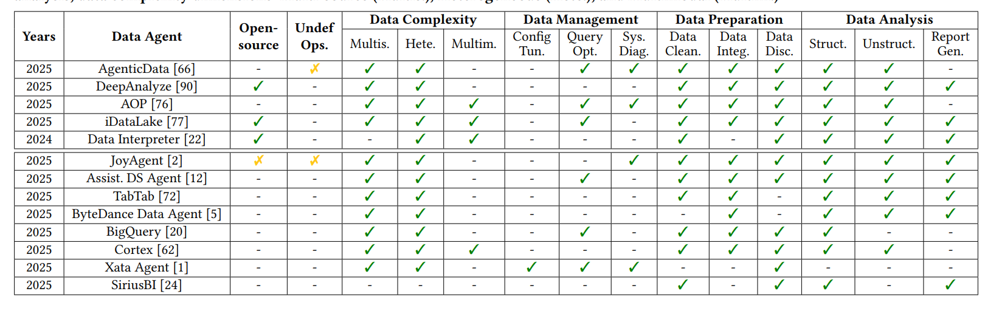

## General LLM Agents vs. Data Agents

| Aspect | General LLM Agents | Data Agents |
| --- | --- | --- |
| **Primary Focus** | *Task and Content Centric:* Completing defined tasks or generating content. | *Data-Lifecycle Centric:* Data management, preparation, and analysis. |
| **Problem Scope** | *Self-contained and Static:* Acts on explicit instructions and a finite prompt. | *Exploratory and Dynamic:* Actively explores and navigates vast, dynamic data lakes. |
| **Input Data** | *Small-Scale and Ready-to-Use:* Typically receives manageable, clean inputs. | *Large-Scale and "Raw":* Designed to handle heterogeneous, dynamic, and noisy raw data. |
| **Tool Invocation** | *General-Purpose Toolkit:* Web search, calculators, OCR, image generators, etc. | *Specialized Data Toolkit:* DB loaders, SQL equivalence checker, visualization libraries, etc. |
| **Primary Output** | *Generative Artifacts:* Human-consumable product: dialogues, reasoning, images, etc. | *Data Products and Insights:* Config, processed data, insights, visualizations, analytical report, etc. |
| **Error Consequence** | *Localized:* Typically affects limited to only the direct output. | *Cascading:* Errors can cascade, affecting downstream insights. |

## Comparison

## Survey files

|  Survey |   Date |
| ---     | ----    |
|[Data Agents: Levels, State of the Art, and Open Problems](https://arxiv.org/html/2602.04261v1)|04 Feb 2026|
|[Data Interpreter: An LLM Agent For Data Science](https://arxiv.org/abs/2402.18679)|15 Oct 2024|
